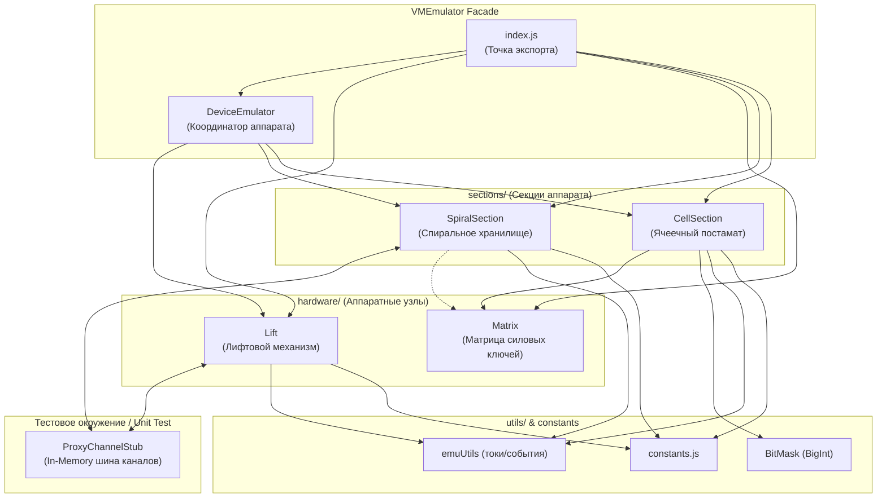

# VMEmulator — Эмулятор полевого уровня вендингового аппарата

Модуль `VMEmulator` предназначен для автономного тестирования и отладки программного обеспечения промышленного вендингового аппарата без подключения физического контроллера, силовых плат и MQTT-брокера. Эмулятор воспроизводит аппаратные реакции датчиков и приводов поверх тестового стаба `ProxyChannelStub`.

---

## 1. Назначение и концепция

* **Изоляция логики от окружения:** Все взаимодействие между управляющим кодом (`ClassSpiralSectionLift`, `ClassSpiralSectionStorage`, FSM секций) и физическим уровнем происходит через интерфейс каналов `ProxyChannel`. `VMEmulator` перехватывает команды управления актуаторами (моторы, замки, питание) и имитирует ответы датчиков (токи, концевики, импульсы уровней).
* **Модульность и расширяемость:** Физические исполнительные узлы (`hardware/`) отделены от логики секций аппарата (`sections/`), что позволяет комбинировать их в произвольных конфигурациях или создавать альтернативные реализации узлов (например, винтовой, цепной или оптический лифт).
* **Симуляция нештатных ситуаций (Fault Injection):** Эмулятор позволяет воспроизводить короткие замыкания (КЗ), обрывы питания, пробои силовых ключей матрицы, дребезг контактов и заклинивание механизмов.

---

## 2. Архитектура и структура каталога

```
js/VMEmulator/
├── index.js                     # Единая точка экспорта компонентов эмулятора
├── hardware/                    # Исполнительные механизмы и аппаратные узлы
│   ├── Lift.js                  # Эмулятор привода, датчиков и движения лифта
│   └── Matrix.js                # Эмулятор силовой матрицы коммутации ключей
├── js/
│   ├── DeviceEmulator.js        # Фасадный координатор устройства (Lift + Sections + Box)
│   ├── constants.js             # Шлюз констант (токи, напряжения, коды FAULTS)
│   ├── sections/                # Секции аппарата
│   │   ├── SpiralSection.js     # Спиральное хранилище (полки, тамперы, моторы)
│   │   ├── CellSection.js       # Ячеечный постамат (замки, матрица, BitMask)
│   │   └── CellSectionConstants.js # Физические и программные константы постамата
│   └── utils/                   # Вспомогательные утилиты
│       ├── emuUtils.js          # Расчет диапазонов токов, константы событий и целей
│       └── BitMask.js           # Автономная BigInt-битовая маска состояния ячеек
└── res/
    └── README.md                # Документация модуля
```

---

## 3. Схема взаимодействия компонентов



---

## 4. Справочник компонентов (API Reference)

### 4.1. Hardware: `Lift` (`hardware/Lift.js`)
Эмулирует движение лифта каретки по вертикали, срабатывание нижнего (`liftBottomTamper`) и верхнего аварийного (`liftTopTamper`) концевиков, импульсы оптического датчика уровней полок (`liftLevelSensor`), а также энергопотребление привода (`current`, `voltage`, `psuWork`).

* **`seedDefaultHardware({ atBottom = true })`** — инициализация начального состояния (по умолчанию на нижнем концевике, мотор `STOP`, ток покоя, 24V).
* **`attachMotorBehavior({ workCurrent, stopCurrent, shortOnStart, onStartMove })`** — автоматическая реакция на команды мотора в канале `liftMotorCtrl2` (`UP`, `DOWN`, `STOP`).
* **`simulateTravel({ stepsCount, reachBottom, startDelayMs, stepIntervalMs })`** — симуляция проезда заданного числа уровней с генерацией импульсов или остановки на концевике.
* **`setCurrent(ampValue, { pushToBuffer, samples })`** / **`setVoltage(voltValue)`** — прямое задание электрических параметров и заполнение циклических буферов.
* **`pulseLevelSensor(pulseWidthMs)`** — генерация единичного импульса прохождения полки.
* **`triggerTopTamper()`** — аварийное срабатывание верхнего концевика (перелет).

### 4.2. Hardware: `Matrix` (`hardware/Matrix.js`)
Эмулирует двухкоординатную силовую сетку коммутации ключей (строки `source` / столбцы `ground`).
* **`setSource(col, val)`** / **`setGround(row, val)`** — включение/выключение плеч коммутации.
* **`countActive()`** — количество одновременно замкнутых пересечений (должно быть не более 1).
* **`onOn({ row, col })`** / **`onOff({ row, col })`** — события замыкания/размыкания конкретной ячейки.
* **`injectSourceStuckOn(row)`** / **`injectGroundStuckOn(col)`** — симуляция аппаратного пробоя силового ключа (залипание во включенном состоянии).
* **`clearStuck()`** — сброс симулированных неисправностей.

### 4.3. Sections: `SpiralSection` (`js/sections/SpiralSection.js`)
Эмулирует спиральное хранилище: моторы вращения спиралей, фазную коммутацию шагов драйвера матрицы (`matrixCtrlChannel`), тамперы исходного положения спиралей по рядам (`spiralTamperChannels`) и токовую нагрузку.
* **`seedDefaultHardware()`** — инициализация датчиков хранилища в покое (все тамперы замкнуты `TAMPER_ON`, ток IDLE).
* **`attachMatrixBehavior({ silentAck, driverError, shortOnStep1, onMotorFullStart })`** — реакция на двухшаговые команды `MotorStep` (`On: step 1/2`, `Off: step 1/2`) с квитированием в `${matrixCtrlChannel}-value`.
* **`simulateRotations({ cols, rotationsCount, firstPulseDelayMs, betweenPulsesMs })`** — симуляция заданного числа оборотов спирали (размыкание и замыкание тампера ряда с задержкой антидребезга `TAMPER_DEBOUNCE`).
* **`setRowTamper(row, isOn)`** / **`pulseRowTamper(row, pulseOffMs)`** — прямое переключение концевика ряда.

### 4.4. Sections: `CellSection` (`js/sections/CellSection.js`)
Эмулирует ячейки постамата поверх `ProxyChannelStub` по единому архитектурному стандарту со `SpiralSection`:
* **`seedDefaultHardware({ allClosed = true })`** — инициализация всех 50 концевиков `tamperChannels` в состояние закрыто (`1`), сброс портов ключей матрицы в `0`, установка тока холостого хода `idle`.
* **`attachPortBehavior(opts)`** — подписка на дискретные каналы строк и столбцов матрицы (`portChannels`), симуляция фазного включения соленоида, подача рабочего тока соленоида (`~3.0 А`) и автоматическое отщелкивание концевика ячейки (`tamperChannels[idx] = 0`).
  * Флаги инжекции аварий: `shortOnStep1` (утечка тока на строке GND `> 0.05 А`), `shortOnStep2` (КЗ соленоида `> 4.5 А`), `stuckLowOnStep3` / `stuckHighOnStep4` (залипание ключей).
* **`simulateUnlock({ autoCloseAfterMs })`** — симуляция успешного открытия ячейки при включении ключей с опциональным авто-закрытием дверцы клиентом через заданное время.
* **`setCellTamper(index, isClosed)`**, **`openCell(index)`**, **`closeCell(index)`**, **`pulseCellTamper(index)`** — прямое управление концевиком ячейки.
* **`setCurrent(ampValue, opts)`** / **`pulseCurrent(...)`** / **`setVoltage(...)`** — управление электрическими параметрами цепи замков.
* **`getState()`** / **`cleanup()`** / **`reset()`** — телеметрия, отписка от каналов и сброс таймеров.

### 4.5. Фасад: `DeviceEmulator` (`js/DeviceEmulator.js`)
Объединяет все секции и общие каналы аппарата (датчик открытия сервисной двери `door`, датчик выдачи товара `boxChannels.optic`, замок окна выдачи `boxChannels.lock`).
* **`seedDefaults()`** — комплексная инициализация датчиков всех подсистем в состояние готовности.
* **`getState()`** — сводное состояние лифта, спирального хранилища и постамата.
* **`cleanup()`** / **`reset()`** — остановка активных таймеров и сброс состояния.

### 4.6. Utils (`js/utils/`)
* **`BitMask`** — высокопроизводительная битовая маска произвольной разрядности на `BigInt` (`setUnlocked`, `setLocked`, `isLocked`, `unlockedCount`, `lockedCount`).
* **`emuUtils`** — расчет репрезентативных точек в токовых диапазонах: `peekValueInRange([low, high])`, `getRangeAbove(...)`, `getRangeBelow(...)`.

---

## 5. Примеры использования в тестах

### Тестирование лифта
```javascript
const { Lift, peekValueInRange } = require('../../../../VMEmulator');
const { ProxyChannelStub } = require('../../helpers/ProxyChannelStub');

const stub = new ProxyChannelStub();
const emuLift = new Lift({ proxy: stub, channels: liftChannels });

emuLift.seedDefaultHardware({ atBottom: true });

// Настройка авто-реакции: при подаче "UP" каретка проходит 3 уровня
emuLift.simulateTravel({ stepsCount: 3 });

await liftService.ElevateToLevel(3);
assert.equal(liftService.Level, 3);
```

### Тестирование спиральной секции
```javascript
const { SpiralSection } = require('../../../../VMEmulator');

const emuStorage = new SpiralSection({ proxy: stub, channels: storageChannels });
emuStorage.seedDefaultHardware();

// Симуляция успешного оборота спирали при включении мотора
emuStorage.simulateRotations({ rotationsCount: 1 });

await storageService.Dispense({ row: 1, column: 2, quantity: 1 });
```

### Тестирование постаматной секции
```javascript
const { CellSection } = require('../../../../VMEmulator');

const emuCell = new CellSection({ proxy: stub, channels: cellChannels, size: { rows: 10, cols: 5 } });
emuCell.seedDefaultHardware();

// Симуляция отпирания ячейки при включении ключей с авто-закрытием дверцы через 500 мс
emuCell.simulateUnlock({ autoCloseAfterMs: 500 });

await postomatService.ProcessCell([{ row: 2, column: 3 }]);
```

---

## 6. Регламент расширения

1. **Добавление нового аппаратного компонента:**
   - Реализовать класс компонента в `hardware/<ComponentName>.js`.
   - Зарегистрировать экспорт в `index.js`.
2. **Добавление новой секции аппарата:**
   - Реализовать секцию в `js/sections/<SectionName>.js`.
   - При необходимости подключить секцию в координатор `DeviceEmulator.js` и зарегистрировать в `index.js`.
3. **Добавление нового сценария аварии:**
   - Использовать методы `setCurrent()`, `setVoltage()` или флаги в `attachMotorBehavior()` / `attachMatrixBehavior()` без изменения боевого кода сервисов.
